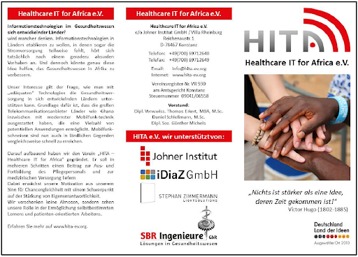
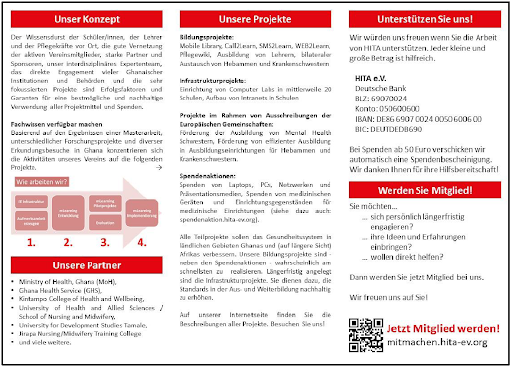
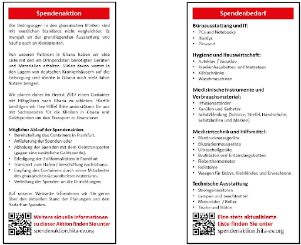

## Main activities

- Follow-up of the work meetings that took place on December 19, 2016 in Inverness, Scotland with representatives of Interactive Health Ltd., NHS Highland, University of Edinburgh and University of Highlands and Islands to discuss possible joint project applications (January-February 2017)
- Attending the Africa Health Agenda International Conference. There, working talks to prepare upcoming project applications with representatives of Interactive Health Limited (Alan White), AMREF and Philips Research Africa (Nairobi, Kenya, March 7-9, 2017)
- Signing of a memorandum of understanding with the School of Nursing and Midwifery (SONAM), University of Health and Allied Sciences (UHAS), Ho, Ghana as part of the preparation of the project “Campus-WLAN + Computer Lab for School of Nursing and Midwifery, UHAS , Ho” (March 2017)
- Working discussions with representatives of other organizations that may be involved in the upcoming project applications: Ministry of Health, Dodowa Health Research Center and ImpactHub Accra (Accra, Ghana, March 2017)
- Conception and preparation of a project application (“Resourceful – Smart Learning Solutions for Low-resource Environments: A Full-scale Pilot in the Nursing & Midwifery Sector in Rural Sub-Saharan Africa”) within the framework of the EU research framework program Horizon2020, Call ICT-39- 2017 “International partnership building in low and middle income countries”. Project consortium: HITA (Lead); Ministry of Health, Ghana; University of Health and Allied Sciences, Ho, Ghana; University for Development Studies, Tamale, Ghana; NHS Highland, UK; ImpactHub Accra, Ghana; University of Turku, Finland; Turku University of Applied Sciences, Finland; AMREF Health Africa, Kenya; Kintampo College of Health and Well Being, Ghana; Sefwi Wiawso Nursing & Midwifery Training College, Ghana; Nurses’ and’ Midwives Training College Tamale, Ghana; Midwifery/Health Assistants Training School, Tepa, Ghana; Jirapa Nursing And Midwifery Training College, Ghana; Chipata Central Hospital, Zambia (January-April 2017)
- Participation in the design and preparation of a project application (“MHSkills4Africa” within the framework of the EU research framework program Horizon2020, Call SC1-HCO-07-2017 “Global Alliance for Chronic Diseases (GACD) prevention and management of mental disorders”. Project consortium: empirica GmbH, Bonn (Lead); HITA; Ministry of Health, Ghana; University of Health and Allied Sciences, Ho, Ghana; University for Development Studies, Tamale, Ghana; NHS Highland, UK; Interactive Health Ltd., UK; ImpactHub Accra, Ghana; Turku University of Applied Sciences, Finland; Dodawa Health Research Centre, Ghana; AMREF Health Africa, Kenya; Sefwi Wiawso Nursing & Midwifery Training College, Ghana; Jirapa Nursing And Midwifery Training College, Ghana; Chipata Central Hospital, Zambia; University of Zambia (January -April 2017)
- Design, implementation and evaluation of a quantitative survey among 300 SONAM students on the use of computers and mobile phones during training, in cooperation with Dr. Robert Kaba/SONAM (Frankfurt, June 2017; Ho, Ghana, July 2017; Bonn, September 2017)
- Conception, implementation and evaluation of qualitative surveys (in-depth interviews) with students and teachers at SONAM (Ho, Ghana, July 2017; Bonn, September 2017)
- Further preliminary surveys for the planned implementation of a WLAN and a computer lab at SONAM (Ho, Ghana, July 2017)
- Preparation and implementation of a fundraising campaign for the collection of discarded but serviceable PCs, screens, printers and other peripheral devices as well as medical aids as part of a shipment by container to Ho, Ghana, planned for next spring (May-December 2017)
- Control of the donated medical aids by experts; Organization of the transport of the donated goods from their current location to the warehouse in Bad Mergentheim (September-December 2017)
- support of dr Robert Kaba, UHAS, Ho preparing a project application at the DAAD (October 2017)
- Technical design of the project “Campus-WLAN + Computer Lab for School of Nursing and Midwifery, UHAS, Ho” by HITA experts; Creation of procurement lists for required infrastructure components and comparison with list of donated goods (November-December 2017)
- Planning of the logistical handling of the transport of the donated goods by container shipping (November-December 2017)

## Board meetings and general assembly

- Board meetings were held on February 7th, April 5th, May 9th, May 23rd, September 6th. and October 9th 2017.
- A working meeting with the participation of other HITA members took place on May 23, 2017.
- The general meeting took place on May 16th, October 11th, and November 7th 2017.

## Membership development

Total number and change compared to the previous year:

| Status | Total | New in 2017 |
| --- | ---: | ---: |
| Members | 28 | 4 |
| Supporting members | 1 | 1 |
| Sponsors | 4 | 3 |

## Public relations

### Presentations

HITA’s activities were presented at the following public events:

- Presentation at the Institute Day by Daniel Schleßmann and Thomas Erkert (July 2017)
- Lecture “Mobile Nursing Training in Africa” by Thomas Erkert at the “2. Virtual Nursing Conference” of the Network for Innovations and Technology in Nursing (NITiP), September 6th, 2017, see [hita-ev.org](http://www.hita-ev.org/?p=3502)

### Online presence

The HITA website was continuously maintained, further developed and updated with the latest content over the entire reporting period. The reports published included in particular:

- Report on participation in the Africa Health Agenda International Conference 2017 in Nairobi and the subsequent trip to Accra and Ho (April 2017), see [hita-ev.org](http://www.hita-ev.org/wp-content/uploads/2016/05/Reisebericht_Ghana-2017_M%C3%A4rz.pdf)
- Essay by HITA expert “The Universal History: Learning from the Past” (June 2017), see [feinripp.net](http://www.feinripp.net/lifestyle/documentary/ghana-report-no-15-die-universelle-geschichte-lernen-aus-der-vergangenheit/)
- Reports of the trip to Ghana by HITA expert Maximilian Glätzner in the summer of 2017 (July-August 2017), see [hita-ev.org](https://www.hita-ev.org/?page_id=3382)
- Subpage for the HITA fundraiser with information and donation form (July 2017), see [hita-ev.org](https://www.hita-ev.org/?page_id=632)
- Press release “A Christmas present in large version – HITA thanks all members, friends and supporters this year, is looking for new contributors and reports on the upcoming container shipment of high-quality medical equipment and computers to Tema in Ghana” (December 2017), see [hita-ev.org](http://www.hita-ev.org/wp-content/uploads/2017/05/Pressemitteilung-HITA-e%20.V.-Weihnachten-2017.pdf)

In January 2017, feedback on the HITA Facebook page exceeded 3000 likes. 5000 likes had already been reached in July.

In June 2017, HITA presences on Twitter, LinkedIn, Instagram, Google+, Pinterest, Flickr and Tumblr were created and went online.

### Flyers

In July 2017, an image flyer was created and printed on the occasion of the fundraising campaign, see Fig. below.

