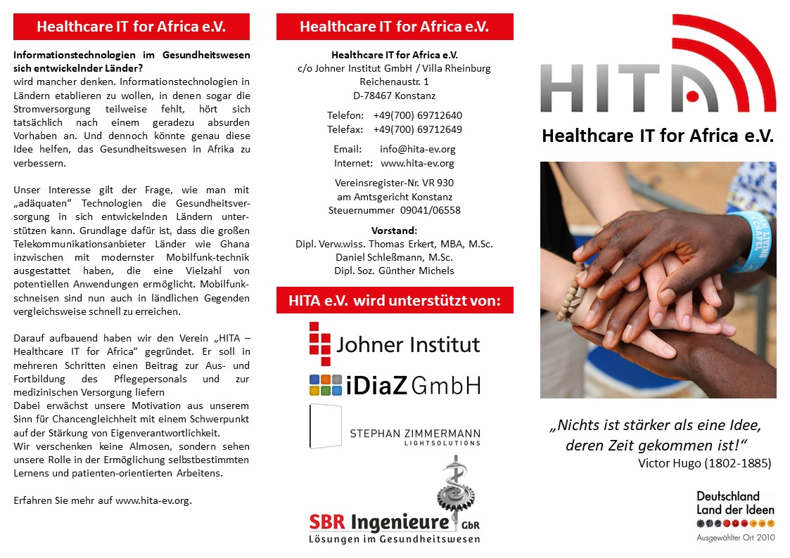
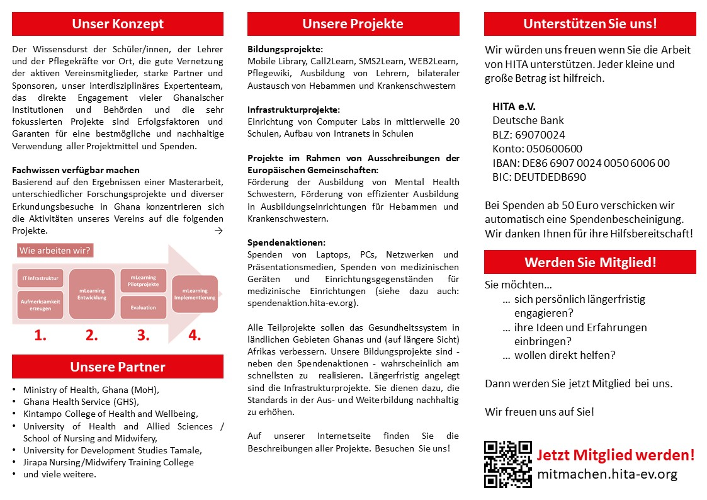
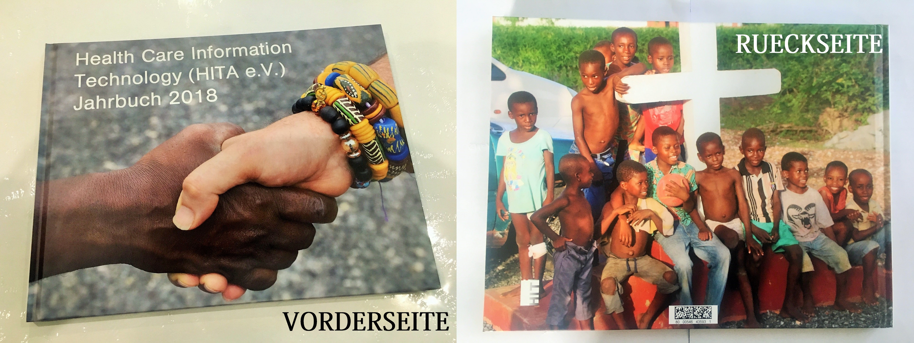

## Main activities

- Further talks on the cooperation between HITA and the Carlo-Mierendorff-Schule, Frankfurt. Content support for activities through which teachers working there inform their classes about the situation in Ghana and design and implement concrete aid measures (e.g. collection of donations in kind) (January-December).
- Meetings with IT tutors and School of Nursing and Midwifery leadership (SONAM/UHAS) and University senior leadership (UHAS) on next steps in the collaboration (4/14-22/2019).
- Design, conduct and analysis of individual and group interviews for data collection for the evaluation of the impact of the intervention “Implementation of a Campus WLAN as well as Computer Labs at SONAM” (14.-22.4.2019).
- Site visits and discussions (together with the representatives of Carlo Mierendorff School) with the school management at four general education schools in Ho, Ghana: Springs Preparatory School; Mawuli School; Mawuku Girls Senior High School; Ola Girls Senior High School (14.-22.4.2019).
- On-site visit to Adaklu, where HITA Board Chair Thomas Erkert was named “Development Chief” in 2018, and discussions with the wife of the district’s traditional chief, as well as other individuals and activists, on ways to support the region with the resources available to HITA (4/14-22/2019).
- Preparatory work for the preparation of a grant application to the Else Kröner-Fesenius-Stiftung (EKFS) including initial submission and subsequent consultations (April-November)
- Preparatory work for the preparation of an application for a small project grant from the German Federal Ministry for Economic Cooperation and Development (BMZ)(April-December)
- Supporting the decision of the Carlo-Mierendorff-School regarding the selection of a suitable partner school in Ho, based on the results of the preliminary discussions during the working trip in April. The decision is made for Mawuku Girls Senior High School (April-September 2019).
- Preparation and implementation of a second fundraising campaign to collect decommissioned but serviceable PCs, monitors, printers, and other peripheral equipment, as well as medical supplies, as part of a shipment by container to Ho, Ghana planned for the end of the year (August-December 2019).
- Assist Carlo Mierendorff School in soliciting donations for Ho friendly schools (August-December 2019).
- Participation in the competition “Hessian Environmental School 2018/2019” in cooperation with the Carlo-Mierendorff-Schule; receipt of the award from State Secretary Beatrix Tappeser (HMUKLV) and Ministerialdirigent Jörg Meyer-Scholten (HKM) at the award ceremony in Großkrotzenburg on 22.10.2019
- Planning and supervision of the logistical handling of the transport of donated goods by container shipping (August-December 2019).
- Technical design of the project “Upscaling of eLearning capacity at School of Nursing and Midwifery, UHAS, Ho” by HITA experts; preparation of procurement lists for required infrastructure components and matching with list of donated goods (September-November 2019).
- Technical design of the project “Computer Labs for selected General Education Schools in Ho” by HITA experts; preparation of procurement lists for required infrastructure components and matching with list of donated goods (September-November 2019).
- Planning and preparation of the project “Targeted support for Adaklu” in cooperation with Chances Foundation and the local development aid group “Dreams Alive” (August-December 2019).
- Preparing for the distribution of donated medical supplies to selected health facilities in Ho, Adaklu-Waya and Adaklu-Hasu (Dec. 27-31, 2019).
- Begin distribution of toys and school supplies donated by the to selected schools in Ho and Hasu (Dec. 27-31, 2019).
- Supporting the representatives of the Carlo Mierendorff School in discussions with the management of the Mawuku Girls Senior High School about the concrete design of the school partnership (27.-31.12.2019)
- Preparing for the installation of computer labs in four schools in Ho (27-31 Dec 2019).

## Board meetings and general assembly

Board meetings were held on 3/14/2019 and 10/15/2019.

Working meetings with participation of other HITA members were held on 18.01., 14.03., 18.05., 18.06., 08.08., 10.09., 13.10., 21.10. and 07.12.2019 will take place.

The general meeting was held on 17.10.2019.

## Membership development

After an adjustment of the membership statistics, we had 42 members remaining in the association as of the reporting date, 12/31/2019. During the year, 4 new members were recruited.

## Public relations

### Presentations

HITA’s activities were presented at the following public events:

- 07.01.2019: University Hospital Frankfurt, Dr. Henrik Schäfer: Presentation HITA
- 25.02.2019: CBC, Computer Business Center, Lyoner Str. 20, Frankfurt am Main, Managing Director Marc Heyer: Presentation HITA
- 25.03.2019: Carlo-Mierendorff-Schule, teaching day, presentation of HITA and discussion with students of grade 8.
- 09.05.2019: Carlo Mierendorff School, theater evening, lecture
- 16.10.2019: Carlo-Mierendorff-Schule, conference, lecture and discussion
- 19.10.2019: Info evening on recruiting new members in Oberursel near Frankfurt, lecture and discussion
- 22.10.2019: Presentation of HITA together with the Carlo-Mierendorff-School, award ceremony Hessian Environmental School in Großkrotzenburg.
- 08.11.2019: University of Mannheim: Prof. Kirstin Kohler. Presentation of HITA projects in the InnoLab of the university.
- 18.11.2019: Carlo-Mierendorff-Schule, Frankfurt, Presentation to the Comprehensive School Advisory Board

### Online presence

The HITA website was continuously maintained, further developed and updated with the latest content over the entire reporting period. The published reports and audio files included in particular:

- Report on the working trip over Easter (April 2019), cf. [hita-ev.org](https://www.hita-ev.org/?p=4598)
- Press release “Our second container is almost full! We’re still looking for donations!”, September 2019, cf. [hita-ev.org](https://www.hita-ev.org/?p=4666)
- “HITA Radio” feature – interview with Daniel Gerlach, new HITA board member (October 2019, see. [hearthis.at](https://hearthis.at/hita-radio/daniel-gerlach/)
- Presentation of the “Hessian Environmental School” award to the Carlo Mierendorff School together with HITA on 22.10.2019, cf. [hita-ev.org](https://www.hita-ev.org/?p=4777)
- “HITA Radio” feature – interview with Rachida Aouad, teacher at Carlo Mierendorff School (November 2019), see. [hearthis.at](https://hearthis.at/hita-radio/rachida-aouad/)
- “HITA Radio” feature – interview with Petra Knott, teacher at Carlo Mierendorff School (December 2019), see. [hearthis.at](https://hearthis.at/hita-radio/petra-knott/)
- “HITA Radio” feature – interview with HITA Board Chair Thomas Erkert on the upcoming HITA work trip to Ghana (December 2019), cf. [hearthis.at](https://hearthis.at/hita-radio/thomas-erkert-1219/)
- Announcement of the end-of-year HITA work trip (December 2019), cf. [hita-ev.org](https://www.hita-ev.org/?p=4803)

### Flyer

In September 2019, an updated image flyer was created and printed on the occasion of the second fundraising event, see Fig. below.

### Yearbook 2018

In February 2019, a 58-page, richly illustrated yearbook was published documenting last year’s activities of the association on the ground in Ho and Adaklu.

