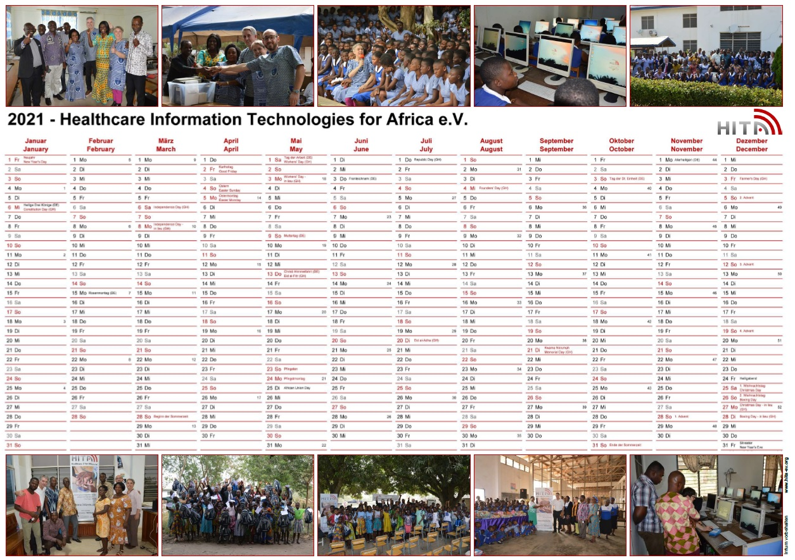

## Main activities

- Working trip to Ho (27.12.2019 – 12.01.2020)
- On-site discussions and visits (together with the representatives of the Carlo Mierendorff School) with the school management at four general education schools in Ho, Ghana: Springs Preparatory School; Mawuli School; Mawuku Girls Senior High School; Ola Girls Senior High School;
- Successful installation and testing of the computer labs in the four schools;
- Preparation, implementation and follow-up of a public event in Adaklu-Waya to hand over 80 school backpacks and utensils donated by HITA sponsors to students from low-income families, as well as IT components and hospital equipment to selected local health facilities;
- Discussion with Togbe Lablulu, traditional head of Adaklu-Waya, about future collaborations for the benefit of the community’s population;
- Final planning and implementation of measures as part of the project “Upscaling of eLearning capacity at School of Nursing and Midwifery, UHAS, Ho” by HITA experts;
- Meetings with the IT tutors, the management of the School of Nursing and Midwifery (SONAM/UHAS) and the management level of the university (UHAS) about the next steps in the cooperation;
- Data collection (individual and group interviews; observations) for the evaluation of the project “Upscaling of eLearning capacity at School of Nursing and Midwifery, UHAS, Ho” by HITA experts;
- Cooperation with Mannheim University of Applied Sciences, in which students and HITA are developing an app for documenting symptoms of illness and providing patient history for regions that have only limited access to modern healthcare systems (January-December);
- Implementation, together with the Carlo Mierendorff School, of regular video conference meetings with the management and interested teachers of the partner school Mawuku Girls Senior High School (February-December);
- Mailing campaign of hygiene articles for women at the Mawuko school to bridge the pandemic-related shortage of this type of goods (April-May);
- Preparation of a funding application for a small project funding by the Schmitz Foundation, financed with funds from the Federal Ministry for Economic Cooperation and Development (BMZ) (April-December);
- Supporting the Grow Your Dream Foundation in planning and financing a campaign for local production and distribution of face masks to needy school children in Adaklu (April-June);
- Support for the University of Health and Allied Sciences, School of Public Health, Hohoe (Prof. Francis Zotor) in submitting an application for an extensive research project as part of the British UKRI/NIHR funding program for research on COVID-19 (April-August);
- Support for the highly talented musician and local activist Celestin Etiam from Adaklu in his efforts to complete his education with a degree in Germany, funded by a HITA supporter family (February-December);
- Accompaniment of a master’s student (ethnology) at the Goethe University in Frankfurt, who could be persuaded to write her master’s thesis in Ghana on a HITA-relevant topic (July-December);
- Discussion of a possible cooperation with the Botswana Harvard School of Public Health in several video conferences (October-November);
- Conception and creation of a website for the partner organization Grow Your Dream Foundation, Adaklu (October-November);
- Publication of appeals for donations at Christmas time (December).

## Board meetings and general assembly

Board meetings were held on March 3rd, May 13th, November 12th. and December 9th

During the year, numerous working meetings took place with the participation of other HITA members.

The annual general meeting, originally scheduled for December 17th, 2020, had to be canceled for health reasons and will now take place at the beginning of March 2021.

## Membership development

After cleaning up the membership statistics, we remained in the association with 43 members on the key date, December 31, 2020. Three new members were recruited during the year.

## Public relations

### Presentations

HITA activities were presented at the following events:

- Presentation at the networking evening at the business juniors Heilbronn-Franken – RG Main-Tauber “An audience with the king” (12.03.)
- Presentation of HITA at a company event of the company Zimmermann Lightsolutions, Oberursel (25.11.)

### Press releases

- Press release “Working Together for Adaklu – Handover of Schoolbags, Computer Labs and Medical Equipment to the People of Adaklu” (January), see [hita-ev.org](https://www.hita-ev.org/wp-content/uploads/2014/08/2020_01-Press-Release-Working-together-for-Adaklu.pdf)
- Press release: “Event ‘Audience with the King’ on March 12, 2020 in Bad Mergentheim” (March)
- Press release together with the Mannheim University of Applied Sciences “University project in Germany and video conference with experts in Ghana: This is how a new kind of health app is created for Ghana” (June)

### Online presence

The HITA website was continuously maintained, further developed and updated with the latest content over the entire reporting period. The published reports and audio files included in particular:

- Together for Adaklu – Container Projekt II (January 2020), see [hita-ev.org](https://www.hita-ev.org/?p=4860)
- Press review Container Projekt II (February 2020), see [hita-ev.org](https://www.hita-ev.org/?page_id=4828)
- Report on HITA working trip to Ho, Ghana (March 2020), see [hita-ev.org](https://www.hita-ev.org/?p=4887)
- First report on the current situation in Ghana and the Adaklu region “What Covid-19 means for rural Ghana – a first report from Adaklu, Volta Region” (April 2020), see [hita-ev.org](https://www.hita-ev.org/?p=4904)
- Ghana Report No. 29 – Interview with Jacob Sedemor & Johnson Agamah on the local Covid-19 situation (May 2020), see [hearthis.at](https://hearthis.at/hita-radio/jacob-sedemor-05-2020/)
- Video conference between Ghana and Mannheim University of Applied Sciences (June 2020), see [hita-ev.org](https://www.hita-ev.org/?p=4149)
- HITA radio contribution 17, interview with Thomas Erkert: “Mawuku School, cooperation agreement and Covid-19 in Ghana” (June 2020), see [hearthis.at](https://hearthis.at/hita-radio/thomas-erkert-08-06-2020/)
- HITA radio contribution 18, interview with Thomas Erkert & Daniel Gerlach “Cooperation with the Mannheim University of Applied Sciences & Ghana” (June 2020), see [hearthis.at](https://hearthis.at/hita-radio/erkert-gerlach-15-06-2020/)
- Ghana Report No. 30, Interview with Teacher Joshua Antah on the Covid-19 situation in Jamestown, Accra (June 2020), see [hearthis.at](https://hearthis.at/hita-radio/jacob-sedemor-05-2020/)
- Ghana Report No. 31, Interview with Ernestina Peniana, Principal Mawuku School (June 2020), see [hearthis.at](https://hearthis.at/hita-radio/ernestina-peniana/)
- Ghana report no. 30, Interview with Teacher Joshua Antah on the Covid-19 situation in Jamestown, Accra (June 2020), see [hearthis.at](https://hearthis.at/hita-radio/celestin-wonu-07-2020/)
- HITA radio report 19, interview with Prof. Kirstin Kohler, Mannheim University of Applied Sciences / inno.space, about the cooperation with HITA (July 2020), see [hita-ev.org](https://www.hita-ev.org/?p=4978)
- Second report on the current situation in Ghana and the Adaklu region “COVID-19: No reason to give the all clear – An update on the situation in Ghana’s Volta region (July 2020) [hita-ev.org](https://www.hita-ev.org/?p=4998)
- Appeal “Support our work with HITA Christmas gifts & HITA calendar” (December 2020), see [hita-ev.org](https://www.hita-ev.org/?p=5035)

A relaunch of the website is planned for spring 2021 in order to optimize the addressees of the target group and to adapt the presentation to the current standard.

### Advertising Materials

In December 2020 a poster and a wall calendar were created and distributed to the members in pdf format. Printed versions are available from HITA for a small fee.

